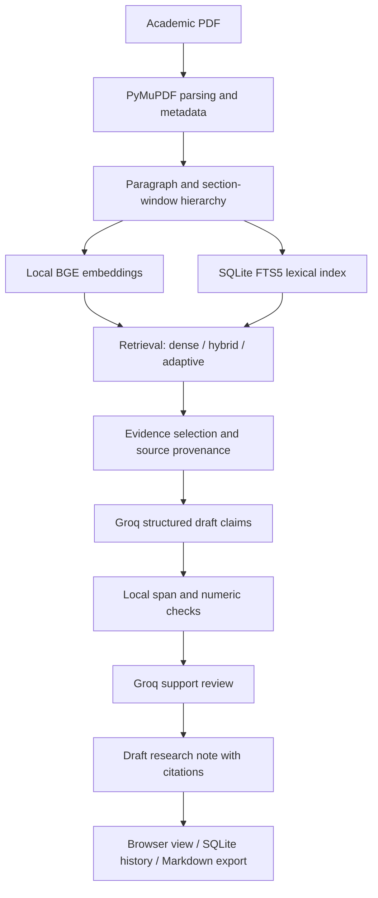

# LiteratureLab

**An evidence-grounded Retrieval-Augmented Generation (RAG) workspace for academic literature analysis and synthesis.**

LiteratureLab is an open-source, local-first **final-year course project** that lets researchers upload academic PDF papers, search them using dense, hybrid, or structure-aware adaptive retrieval, and generate inspectable research notes backed by quotations from the original documents.

Rather than presenting an answer as automatically trustworthy, LiteratureLab connects generated claims to source passages, checks citation references locally, performs an additional LLM support review, and explicitly reports insufficient evidence and limitations.

> **Project status — working prototype (`v0.1.0`).** PDF ingestion, indexing, retrieval, Groq-based synthesis, citations, note history, Markdown export, a browser interface, and evaluation scripts are implemented. The immersive research-journal interface, in-app PDF page flipping/highlighting, conversation threads, and next-generation retrieval features described under **Roadmap** are **planned**, not implemented in this version.

## Why LiteratureLab?

Reading and comparing research papers involves more than retrieving text. Researchers need to identify relevant methods, distinguish measured results from interpretations, compare evidence across publications, and trace claims back to the exact papers that support them.

LiteratureLab explores two connected goals:

1. **Practical literature synthesis:** provide a functional desktop-browser workspace for collecting, querying, comparing, and citing academic papers.
2. **Retrieval research:** compare a transparent structure-aware retrieval policy with dense and hybrid baselines, without claiming an improvement until proper evaluation establishes one.

This is a **course-based prototype and research platform**, not a validated autonomous systematic-review tool or a guarantee of error-free scientific answers.

## Features available now

- **PDF library:** upload English, text-based academic PDFs; detect duplicate uploads by SHA-256; retain original documents and page metadata.
- **Document hierarchy:** extract paragraph records and larger section windows with parent–child relationships.
- **Local CPU embeddings:** use `BAAI/bge-small-en-v1.5` through FastEmbed/ONNX; no local LLM or discrete GPU is required.
- **Three retrieval strategies:**
  - **Dense:** rank paragraph embeddings by vector similarity.
  - **Hybrid:** combine dense search with SQLite FTS5/BM25 using Reciprocal Rank Fusion (RRF).
  - **Adaptive:** use simple query heuristics to search section windows for broad questions, or coarse sections followed by child paragraphs for focused questions.
- **Source-aware evidence selection:** prioritize explicitly selected or recognized papers and enforce a 1,600-word evidence ceiling.
- **Structured synthesis:** generate cited draft findings and separately labeled inferences using a Groq-hosted model.
- **Citation safeguards:** resolve evidence IDs to copied source spans, reject invalid quotations and certain unsupported numerical claims, and submit remaining claims for a second model-based support review.
- **Evidence inspection:** view retrieved passages and open the original PDF at the cited page in a browser tab.
- **Saved research notes:** store results locally, reuse marked cached results, and export Markdown.
- **Evaluation tooling:** inspect recorded retrieval timing and development-test results; run repeatable local retrieval checks without calling the LLM.

### Not yet implemented

The current app **does not** include an embedded page-turning PDF viewer, exact in-page quotation highlights, streaming step-by-step retrieval animation, persistent multi-turn chat sessions, cross-encoder reranking, Matryoshka embedding-width adaptation, or retrieval-agreement-based escalation. These are proposed extensions, not current capabilities.

## Architecture



**Main components**

| Component | Location | Responsibility |
| --- | --- | --- |
| Corpus and retrieval | `literaturelab/core.py` | PDF validation, extraction, hierarchy, embeddings, SQLite storage, BM25/dense/RRF/adaptive search |
| Synthesis and verification | `literaturelab/synthesis.py` | Structured Groq requests, evidence-span resolution, local claim checks, support review, caching, saved notes |
| API server | `literaturelab/api.py` | Loopback FastAPI endpoints, request validation, PDF serving, safe errors and browser static files |
| Frontend | `web/` | Dependency-free HTML/CSS/JavaScript research workspace, evidence cards, citation navigation and evaluation view |
| Test and evaluation scripts | `tests/`, `scripts/` | Offline regressions, browser checks, seeded real-paper tests and recorded retrieval/live evaluations |
| Reproducible corpus metadata | `demo/manifest.json`, `demo/questions.json` | Pinned public paper versions and development questions |
| Recorded findings | `reports/` | Retrieval measurements, test artifacts, independent development audit and limitations |

The current system stores vectors as SQLite BLOBs and ranks eligible vectors locally. **It does not use FAISS, HNSW, or another approximate-nearest-neighbor index**, so scalability beyond a small research library has not been established.

## Requirements

- **Windows**, with **Python 3.12** recommended for the tested setup.
- Internet access for first-time dependency, embedding-model and public-PDF downloads, and for Groq inference.
- A **Groq API key** with access to the configured model. The tested setting is `openai/gpt-oss-120b`; provider models, free-tier quotas and availability can change.
- Sufficient free disk space for Python dependencies, the approximately 67 MB embedding model, papers and the local index.

The application runs in a browser but binds to **`127.0.0.1`** by default. It is designed for one trusted local user, not public hosting.

## Installation — Windows

Open PowerShell:

```powershell
git clone https://github.com/sitanshukr08/LiteratureLab.git
cd LiteratureLab
powershell -ExecutionPolicy Bypass -File .\Setup.ps1
```

`Setup.ps1` creates a virtual environment, installs pinned dependencies, downloads the pinned BGE ONNX embedding model and the six public demonstration papers (if absent), checks paper hashes, and indexes the demo corpus. It also creates `.env` from `.env.example` if necessary.

Edit **`.env`**:

```dotenv
GROQ_API_KEY=your_groq_api_key_here
GROQ_MODEL=openai/gpt-oss-120b
```

**Never commit your real `.env` or API key.** The file is excluded by `.gitignore`.

Start the application:

```powershell
.\Start.cmd
```

Open **http://127.0.0.1:8765**. Keep the terminal open while using the application. Press **Ctrl+C** to stop the server. If changing `.env`, restart the server.

### Manual startup

After setup, you can also run:

```powershell
.venv\Scripts\python.exe -m uvicorn literaturelab.api:app --host 127.0.0.1 --port 8765
```

## How to use

1. **Choose the corpus.** Use the seeded demo papers or upload your own English, searchable PDF files (up to 20 MB and 200 pages per document). Scanned/image-only PDFs are not supported.
2. **Select papers**, or leave all unchecked to search the entire library. Some named papers may also be recognized from their aliases.
3. **Enter a research question.** For example, *“Compare RAPTOR and HiChunk: how do their retrieval structures differ?”*
4. **Select a retrieval strategy:** Dense, Hybrid, or Adaptive.
5. Click **Inspect retrieval** to see passages and timing without using Groq, or **Synthesize** to produce a source-linked draft research note.
6. **Check the sources.** Select a citation, inspect the original evidence and use **Open source page** to view the relevant PDF page.
7. **Export** the draft note as Markdown or reopen a previously saved result from Research notes.

Results are **drafts requiring human verification**. A valid quotation or a successful model review does not prove that the entire claim is scientifically entailed by its evidence.

## Retrieval strategies explained

| Strategy | Retrieval behavior | Notes |
| --- | --- | --- |
| **Dense** | Query embedding ranked against paragraph embeddings | Simple semantic baseline |
| **Hybrid** | Dense ranking + BM25 lexical ranking merged via RRF | Adds exact-term matching |
| **Adaptive** | Broad questions search section windows; focused questions shortlist parent sections and search their paragraphs | Uses explicit heuristics and may fall back to all eligible paragraphs |

Every strategy uses the same **maximum 1,600-word evidence budget**, although retrieved units differ in granularity. Explicit source selection and paper-coverage checks reduce the risk that one document dominates a multi-paper comparison.

**Research caution:** this adaptive method is a transparent experimental heuristic, not a proven new retrieval algorithm or a demonstrated latency optimization.

## API overview

The FastAPI documentation is available locally at **http://127.0.0.1:8765/api/docs**.

| Method | Endpoint | Purpose |
| --- | --- | --- |
| GET | `/api/status` | Model, library and local setup status |
| GET | `/api/papers` | List indexed papers |
| POST | `/api/papers` | Upload and index a PDF (`multipart/form-data`) |
| DELETE | `/api/papers/{paper_id}` | Delete paper and active index records |
| GET | `/api/papers/{paper_id}/pdf` | Serve the original PDF |
| POST | `/api/search` | Retrieve evidence without calling Groq |
| POST | `/api/ask` | Retrieve evidence, synthesize claims and review support |
| GET | `/api/history` | List saved notes |
| GET | `/api/history/{entry_id}` | Retrieve a saved note |
| GET | `/api/evaluation` | Read recorded evaluation data |

Example retrieval request:

```json
{
  "question": "How does RAPTOR organize evidence?",
  "paper_ids": [],
  "strategy": "adaptive",
  "refresh": false
}
```

An empty `paper_ids` array generally searches the library, subject to recognized paper aliases in the question. `refresh` is relevant to answer caching with `/api/ask`.

## Evaluation and reproducibility

The repository contains **recorded development results** from October 27, 2026—not a held-out, independently validated claim of scientific accuracy.

**Recorded test scope**

- Six pinned public research papers, **114 PDF pages** total.
- **576 paragraph nodes** and **142 section windows**.
- Eighteen development questions, three retrieval strategies, three repetitions each (**162 retrieval runs**).
- **29 automated regression/API/provider tests** recorded as passing, **14 browser checks** recorded as passing, and one real PDF upload/index/search/persistence test recorded as passing.
- An eight-case live Groq check: **seven returned results** and **one explicit free-tier quota failure**.

**Recorded retrieval latency** (warm model, small corpus, on one Windows laptop):

| Strategy | Median retrieval | Sample p95 | Required-paper identity coverage |
| --- | ---: | ---: | ---: |
| Dense | 15.47 ms | 19.82 ms | 100% |
| Hybrid | 17.88 ms | 42.90 ms | 100% |
| Adaptive | 33.45 ms | 53.60 ms | 100% |

**Dense retrieval was faster in this measurement.** Adaptive retrieval has **not** demonstrated a speed advantage. Required-paper identity coverage only measures whether named/relevant paper IDs were present; it **does not** measure fact recall, semantic relevance, citation entailment or answer accuracy. The examples are development/regression questions rather than an untouched test set.

The final live evaluation retained 15 draft claims and withheld five. The qualitative audit found that some generated cross-paper conclusions still overgeneralized their sources despite passing available checks. The full-answer median was **12.426 seconds** among completed calls, including provider/network effects and retries—not just retrieval or local model computation.

See [TEST-REPORT.md](reports/TEST-REPORT.md), [live-audit-final.md](reports/live-audit-final.md), and [security-review.md](reports/security-review.md) for methodology and caveats.

### Run the tests

```powershell
.venv\Scripts\python.exe -m pytest -q
.venv\Scripts\python.exe scripts/check_real_upload.py
.venv\Scripts\python.exe scripts/evaluate.py
```

To run a live Groq evaluation with cache bypass (consumes provider quota):

```powershell
.venv\Scripts\python.exe scripts/evaluate.py --live --fresh
```

With the server running and Playwright Chromium installed, run browser checks:

```powershell
.venv\Scripts\python.exe -m playwright install chromium
.venv\Scripts\python.exe scripts/browser_check.py
```

The browser script is configured to launch the Microsoft Edge channel (`msedge`); Edge must be available on the test machine. A previously seeded cached answer is required for its optional `--synthesize-cached` test.

## Privacy and security model

- PDF parsing, embeddings, retrieval, indices and saved notes remain **local**.
- For synthesis and review, **selected passages and question content are sent to Groq**. Do not upload confidential papers unless their disclosure to the provider is acceptable under your applicable policies.
- The API key stays in the local ignored `.env` and is not sent to the browser.
- The app binds to loopback and applies basic host, origin, request-size and input-validation restrictions.
- PDF uploads and provider responses are untrusted inputs. The app includes safeguards, but they do **not** constitute a full security audit or reliable prompt-injection immunity.
- Uploaded documents and notes are stored as ordinary local files/database content, without application-level encryption at rest.

**Do not expose this prototype to the public internet or a LAN without authentication, isolation, and an additional security review.**

## Known limitations

- No OCR for scans, image understanding, dependable table reconstruction, or mathematical/figure reasoning.
- PDF heading detection and reading order rely on native text/font heuristics; complex multi-column layouts can be parsed incorrectly.
- Citation links open the PDF at a page; the current frontend does not highlight the exact original sentence inside an embedded viewer.
- Structured source-span copying establishes literal provenance, **not** that every scientific interpretation is correct.
- The second support review uses the same provider model family and can share generation errors; both false acceptances and false rejections were observed during development.
- Query-adaptive routing is based on simple patterns. No learned controller, cross-encoder reranker, Matryoshka dimensions, or confidence-based escalation is implemented.
- Retrieval currently loads local index data and ranks candidates without an ANN index; scalability remains unmeasured.
- The 1,600-word evidence cap can omit relevant passages from broad multi-paper questions.
- Saved history consists of individual research notes, not contextual multi-turn conversation threads.
- Groq availability, rate limits and output quality can vary; rate-limit failures are surfaced rather than silently substituted.

## Roadmap — proposed, not implemented

LiteratureLab is intended to evolve into a **desktop-first interactive research journal** where the source material itself becomes part of the research experience.

### Phase 1 — Interactive research journal

- Journal-style Contents page with research history and library navigation.
- Persistent question composer and genuine multi-turn research sessions.
- In-app PDF rendering, page transitions, zoom and direct source navigation.
- Citation-to-PDF highlights based on verified text coordinates.
- User-controlled **Live Follow** and **Manual Reading** modes so source navigation never interrupts reading.

### Phase 2 — Observable retrieval pipeline

- Server-Sent Events for actual backend retrieval-stage updates.
- Live evidence queue, source-selection states and retrieval replay.
- Source-specific diagnostics with measured timing, candidates and evidence budgets.

### Phase 3 — Retrieval research

- Efficient cached or indexed vector search on larger corpora.
- Better document-section parsing, query routing and source-aware selection.
- Optional cross-encoder reranking, dynamic candidate expansion and agreement/sufficiency signals.
- Experiments with multi-resolution embedding representations and selective computation, compared against the current baselines.

### Phase 4 — Stronger evaluation

- Larger **held-out** academic corpus and genuinely unseen questions.
- Human-annotated relevant passages and citation-support judgments.
- Recall@k, MRR, nDCG, passage-level evidence recall, citation support, abstention quality, end-to-end latency and token cost.
- Ablations to isolate which individual retrieval changes improve quality or efficiency.

These planned features are research directions, **not claims of novelty or performance superiority**. Their value must be demonstrated experimentally.

## Project scope and academic integrity

This repository is developed as a **final-year academic course prototype**. It uses and builds on published retrieval and RAG techniques, including dense retrieval, BM25, Reciprocal Rank Fusion, hierarchical document representations and evidence-grounded language generation. Contributions should be described as system design and measured implementation improvements rather than as invented algorithms without prior-art review.

The model's outputs should be treated as **draft analysis**, with source verification performed by the researcher.

## References and useful reading

- [Retrieval-Augmented Generation for Knowledge-Intensive NLP Tasks](https://arxiv.org/abs/2005.11401)
- [Dense Passage Retrieval for Open-Domain Question Answering](https://arxiv.org/abs/2004.04906)
- [RAPTOR: Recursive Abstractive Processing for Tree-Organized Retrieval](https://arxiv.org/abs/2401.18059)
- [Lost in the Middle: How Language Models Use Long Contexts](https://arxiv.org/abs/2307.03172)
- [Enabling Large Language Models to Generate Text with Citations (ALCE)](https://arxiv.org/abs/2305.14627)
- [Groq documentation](https://console.groq.com/docs/overview)
- [FastEmbed documentation](https://qdrant.github.io/fastembed/)
- [Reciprocal Rank Fusion](https://plg.uwaterloo.ca/~gvcormac/cormacksigir09-rrf.pdf)

Exact versions and SHA-256 hashes for the seeded PDFs are recorded in [`demo/manifest.json`](demo/manifest.json).

---

**LiteratureLab — From research papers to inspectable evidence.**
